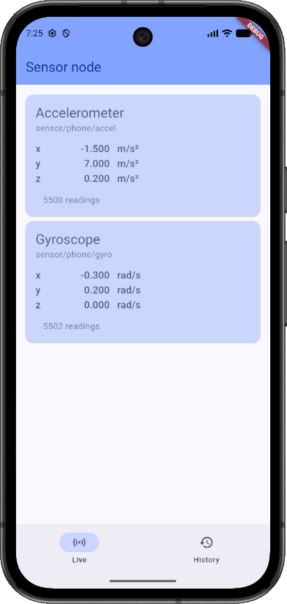
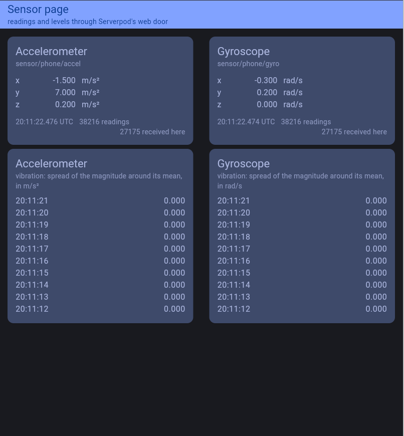
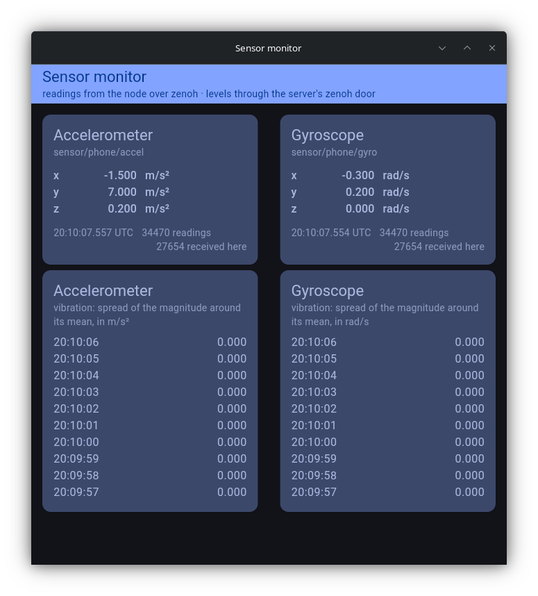

# Serverpod as a Zenoh peer

*Hugo Alberto Garcia, [Bluecorn](https://bluecorn.github.io) · built for Build Something Real, the Serverpod
hackathon, October 2026 · [Run it](#run-it)*

This project integrates Serverpod as a Zenoh peer, in its own process. Robots and sensors communicate directly over
[Zenoh](https://zenoh.io), peer to peer, with no central server. In contrast, [Serverpod](https://docs.serverpod.dev/)'s
protocol is client to server. Serverpod is an application server: endpoints with a generated client, a database behind
an ORM with migrations, and a web server. Putting a Serverpod server on the Zenoh network as one more peer gives the
network an application server. For a Dart and Flutter team the first gain is Serverpod's features on the device network,
and the second is one language from the device to the server to the browser. The use case is the least that shows the
thesis: monitoring a machine's vibration, so that whoever keeps it running sees it live and over the last minutes from a
desk or a browser, without walking to it. A phone strapped to the machine acts as the sensor, publishing its
accelerometer and gyroscope over Zenoh. The server turns the readings into a vibration level per sensor per second, the
spread of the readings' magnitudes around their mean, and keeps the levels in a table; in Zenoh's terms, data in motion
becomes data at rest. It opens two doors onto what it holds: Serverpod endpoints for browsers, which speak no Zenoh, and
a Zenoh query and publication for native apps on the network. A monitor on Linux, the same Flutter app as the phone's in
another role, reads the phone directly and asks Serverpod's Zenoh door for the levels. Every layer is present in its
thinnest real form and tested; this project provides a template for applications on Zenoh and Serverpod. It ran on an
Android emulator and on a Pixel 9a over Wi-Fi; the server and the monitor run on Linux x86_64 only.

<table><tr>
<td valign="top"><a href="docs/phone-live.png"></a></td>
<td valign="top"><a href="docs/page.png"></a></td>
<td valign="top"><a href="docs/monitor.png"></a></td>
</tr></table>

*Fig. 1 to 3, left to right: the phone, its Live tab, a card per sensor; the page in a browser, through the web
door; the monitor on Linux, a column per sensor. Each opens full size.*

## The problem

Serverpod's own picture is a Flutter app and its server. Its introduction says: "call your server endpoints from your
Flutter app through generated, type-safe Dart code. No REST contracts to maintain, no language-switching"
([Introduction](https://docs.serverpod.dev/)). Its endpoints page says: "Endpoints are how your app talks to your
server" ([Working with endpoints](https://docs.serverpod.dev/concepts/endpoints-and-apis)). The server sits at the
centre, and every client reaches it.

Robots and devices are built the other way round: over Zenoh they publish, subscribe and query directly among
themselves, peer to peer, with no server on the path. ROS 2 is among them: the [Robot Operating
System](https://docs.ros.org/), the open-source libraries and tools for building robot applications, can run on Zenoh
natively through `rmw_zenoh` or bridged to it by `zenoh-bridge-ros2dds`, and Zenoh's own team is building
[Hiroz](https://github.com/ZettaScaleLabs/hiroz), an experimental ROS 2 stack written directly on Zenoh. An HTTP backend
reaches such a network today through Zenoh's [REST plugin](https://zenoh.io/docs/manual/plugin-http/), an HTTP server on
a Zenoh node, so the backend stays a client of the network rather than a member of it. The webinar this project
continues (see [Background](#background)) put the Flutter app on that network as a peer, "eliminating the broker/gateway
and the client/server tier every other approach forces between the app and the robot", and said of the server that it
"keeps its place; it just isn't the only door".

What Zenoh brings, by [its own account](https://zenoh.io/docs/overview/what-is-zenoh/), is one protocol from the
microcontroller to the data centre with no bridges; publish-subscribe, queries and computation under one set of
abstractions; and a topology that is peer to peer, brokered or both, decided at runtime. What this project shows of it
is that each pair of peers links directly, so no peer carries another pair's traffic and none is a point of failure for
the others. When the server stops, the monitor keeps receiving the phone's readings, and only the levels stop (the
two-doors table in Architecture).

This project gives the server a second network, Zenoh's, distributed among the devices. A Zenoh session is opened in the
Serverpod process once the server has started and closed in a shutdown task, and nothing in the framework changes. The
server is then both a peer among the devices and a Serverpod server to its clients, and Serverpod's promise of one
language and no REST contracts reaches the device tier.

What it contributes:

1. **A Serverpod server that is a Zenoh peer in its own process:** the session is opened once the server has started and
   closed in a shutdown task, and the framework is unchanged.
2. **The web door:** streaming endpoints that give a browser every reading and the last levels through the generated
   client.
3. **The Zenoh door:** a queryable that answers with the last levels, and each new level published as it is kept.
4. **One Flutter app in two roles:** the sensor node on the phone and the monitor on Linux, with the same view models
   and cards.
5. **A skeleton with every layer present in its thinnest real form,** built test-first, as a template for applications
   on Zenoh and Serverpod.

**What is not claimed.** An HTTP backend could already reach Zenoh through the REST plugin. What is new here is
Serverpod as a Zenoh peer in its own process, which `zenoh_dart` makes possible.

## Background

[Zenoh](https://zenoh.io), an Eclipse project, is a protocol for publish and subscribe, queries and storage between
devices, peer to peer, with no broker. Its site names the fields it serves: robotics, as a next-generation middleware in
place of DDS, ROS 2 included (`rmw_zenoh`); autonomous vehicles and automotive, from V2X to software-defined vehicles;
and IoT and edge computing. [ZettaScale](https://zettascale.tech), which offers it commercially, adds case studies in
agriculture, industry and transportation.

My webinar of 17 June 2026, *Building a UI for Robotics Using Flutter and Zenoh*, hosted by the Eclipse Foundation IoT
([recording](https://www.youtube.com/watch?v=3bz9O3kmryc),
[slides](https://github.com/bluecorn/flutter-zenoh-robotics-ui-webinar)), put a Flutter UI on a real robot arm's Zenoh
network: the live demo went through a thin Zenoh-to-ROS node
([`flutter_zenoh_gateway`](https://github.com/bluecorn/flutter_zenoh_gateway)), and a further spike had no gateway node
([`flutter_zenoh_direct`](https://github.com/bluecorn/flutter_zenoh_direct)). This project puts the server on such a
network too.

The guide [*zenoh in Dart and Flutter*](https://github.com/bluecorn/zenoh-dart-flutter-guide), which I am writing,
teaches Zenoh chapter by chapter while the reader builds two programs by hand and runs them against each other:
`sensorctl`, a Dart command-line collector on the laptop, and `sensor_node`, a Flutter app on Android that publishes
what the phone's sensors read. Both follow Model-View-ViewModel (MVVM), share one pure-Dart package that holds their
Zenoh code, and are built test-driven, every behaviour starting as a failing test. Six chapters, 0 to 5, are published,
and by chapter 5 the phone publishes over Wi-Fi. [`zenoh_sensors`](https://github.com/bluecorn/zenoh_sensors) is the
project those chapters build, with a commit at the end of each chapter; it was begun on 18 September 2026, inside the
hackathon's submission period.

This entry starts from a copy of `zenoh_sensors`, history included. The sensor node, the collector and the shared core,
`sensor_core`, are the guide's work as published, while the server, the page, the monitor role of the node and the
`sensor_domain` package are new. The method of [How it was built](#how-it-was-built) is the guide's, carried over.

Beneath the guide and this entry is [`zenoh_dart`](https://pub.dev/packages/zenoh_dart), which I maintain: Dart bindings
for Zenoh through FFI, Dart's foreign function interface, to zenoh-c 1.8.0, for Linux and Android, at version 1.0.0-rc.1
at this writing. The guide uses it from its first chapter, and so does every Zenoh-speaking program here, through the
one file in `sensor_core` that imports it.

## Architecture

A phone strapped to a machine publishes its accelerometer and gyroscope over Zenoh. The server, a Zenoh peer, streams
the readings to browsers, turns them into a vibration level per second, keeps the levels, answers Zenoh queries on
them, and publishes each one as it is kept:

```
                                        ┌──────────────────────────────────────────────┐
                                        │ zenohd   a router, on the laptop: it         │
                                        │   introduces the peers to one another,       │
                                        │   then carries none of their data            │
                                        └──────────────────────────────────────────────┘

 the phone                              the laptop
┌─────────────────────────────┐         ┌────────────────────────────────────────────────────────────────────────────┐
│ sensor_node   node role     │readings │ sensor_server   Serverpod, and a Zenoh peer                                │
│   a Zenoh peer              │════════►│   Zenoh in:    subscribed to sensor/phone/*                                │
│   put on sensor/phone/accel │         │                └─► a level per sensor per second ──► the archive (SQLite)  │
│   put on sensor/phone/gyro  │ levels  │   Zenoh out:   queryable on archive/phone/**: the last n levels            │
│   History tab: a get on     │◄════════│                each level, as it is kept, put on archive/phone/<sensor>    │
│   archive/phone/**?n=20,    │         │   Serverpod out, for clients without Zenoh:                                │
│   then subscribed to        │         │                readings(): every reading, live                             │
│   archive/phone/*           │         │                recent(n): the last n levels, again each time one is kept   │
└───────╥─────────────────────┘         │   API server :8080                         web server :8082                │
        ║                               └────╥────────────┬──────────────────────────────────────┬───────────────────┘
        ║                                    ║            │                                      │
        ║ live readings,                     ║            │ WebSocket: readings(),               │ HTTP: the page
        ║ straight from                      ║            │ recent(20)                           │
        ║ the phone                          ║            │                                      │
        ║              Zenoh: a get, a reply ║            │                                      │
        ║              per level; then each  ║            │                                      │
        ║              level as it is kept   ║            │                                      │
        ║                                    ║            │                                      │
        ║                                    ║       ┌────▼──────────────────────────────────────▼───────────────────┐
┌───────╨───────────────────────────────┐    ║       │ a browser: sensor_web   Flutter web                           │
│ sensor_node   monitor role, on Linux  │◄═══╝       │   the generated client, no Zenoh                              │
│   a Zenoh peer                        │            │   readings() for the live cards                               │
│   subscribed to sensor/phone/*        │            │   recent(20) for the levels cards                             │
│   get on archive/phone/**?n=20        │            └───────────────────────────────────────────────────────────────┘
│   subscribed to archive/phone/*       │
└───────────────────────────────────────┘
```

*Fig. 4. The topology. Double lines are Zenoh, single lines Serverpod's WebSocket and HTTP.*

`zenohd` introduces the peers to one another and carries none of their data; each pair then links directly. Every peer
runs with multicast scouting off and gossip on and connects to the router as its entry point; the router forwards the
peers it knows to each newcomer, which connects to them:

```
sensor_node (the phone)    zenohd (the router)            sensor_server         sensor_node, monitor role
        │                           │                           │                           │
        ├─ connect <laptop>:7447 ──►│                           │                           │     each peer connects to the
        │                           │◄─ connect 127.0.0.1:7447 ─┤                           │     router, its entry point; the
        │                           │◄─ connect 127.0.0.1:7447 ─┼───────────────────────────┤     phone listens on 7447, the
        │                           │                           │                           │     server on 7448, the monitor
        │                           │                           │                           │     on no port
        │◄─ gossip: <laptop>:7448 ──┤                           │                           │     gossip scouting: the router
        │                           ├─ gossip: <phone>:7447 ───►│                           │     forwards the peers it knows
        │                           ├─ gossip: both ────────────┼──────────────────────────►│     to each one
        │                           │                           │                           │
        │◄═ a direct link ══════════╪═══════════════════════════┤                           │     each pair links directly,
        │◄═ a direct link ══════════╪═══════════════════════════╪═══════════════════════════┤     the newcomer connecting
        │                           │                           │◄═ a direct link ══════════┤     to the ports it was told
```

*Fig. 5. Gossip scouting: each peer connects to the router, the router introduces them, and each pair links directly.*

This is the arrangement ROS 2 uses on a robot with `rmw_zenoh`: by default each node's session is a peer with multicast
scouting off and gossip on, connects to a router on its host at port 7447, and auto-connects to the nodes the router
tells it of ([rmw_zenoh](https://github.com/ros2/rmw_zenoh), its README and its default session configuration). The
difference here is only where the router sits, on the laptop across the Wi-Fi rather than on each host.

The monitor never addresses the server: it names keys, and Zenoh brings the phone's readings straight from the phone.
The server answers only what it alone holds, the archive.

Zenoh is a key/value space, `/` the separator, with four operations on it
([its abstractions](https://zenoh.io/docs/manual/abstractions/)). A **put** writes a value at a key. A **subscriber**
names a key expression and receives every put at a key that matches it: `*` matches one segment, `**` any number of
them. A **queryable** is a computation registered at a key expression, and a **get** on a selector, a key expression
with parameters after `?`, triggers every queryable it matches, which answers with replies, each on a key of its own.
Nothing names a host. The phone puts, the server and the monitor subscribe, and Zenoh carries each value to whoever's
expression matches, over the direct links of Fig. 5. The keys, and what moves on them:

| key | written by | what travels | read by |
|---|---|---|---|
| `sensor/phone/accel`, `sensor/phone/gyro` | the phone: a put per reading, 50 a second for each sensor, stamped with its Zenoh timestamp | `n,x,y,z`: the phone's number for the reading, from 1 for each sensor, and the three axes | the server (its recorder, and a subscription for each browser), the monitor and `sensorctl`, each subscribed to `sensor/phone/*` |
| `archive/phone/**` | the server: a queryable, answering a get with `?n=20` by a reply per level, newest first | `<ISO-8601 time>,<level>` in each reply, on the level's own key | the monitor and the phone's History tab, a get each when they open |
| `archive/phone/accel`, `archive/phone/gyro` | the server: a put per level as it is kept, once a second for each sensor | `<ISO-8601 time>,<level>` | the monitor and the phone's History tab, subscribed to `archive/phone/*` |

The last segment of a key names the sensor, and that is how every program labels a reading or a level it receives. In
Zenoh's terms the readings are data in motion, the archive is data at rest answered by a query, and each kept level is
in motion again the moment it is published. In sequence:

```
sensor_node (the phone)       sensor_server                     sensor_node, monitor role (Linux)
        │                           │                                           │
        │                           │ at start: subscribe sensor/phone/*        │
        │                           │           queryable archive/phone/**      │
        │                           │                                           │ at start: subscribe sensor/phone/*
        │                           │                                           │           subscribe archive/phone/*
        │                           │                                           │
        │                           │◄─── get archive/phone/**?n=20 ────────────┤ the levels cards ask for the levels
        │                           ├──── a reply per level, newest first ─────►│
        │                           ├──── done ────────────────────────────────►│ the get completes
        │                           │                                           │
        ├─ get archive/phone/** ───►│                                           │ the phone's History tab asks the
        │◄──── a reply per level ───┤                                           │ same when first opened, then
        │                           │                                           │ subscribes to archive/phone/*
        │                           │                                           │
        ├─ put sensor/phone/accel ─►│                                           │
        │ as n,x,y,z                │                                           │
        │                           │ into this second's level                  │
        ├───────────────────────────┼──────────────────────────────────────────►│ the same reading: show it with the
        │                           │                                           │ phone's number; count + 1
        │                           │                                           │
        │                           │ a second ends: keep its level             │
        │◄──────────────────────────┼──── put archive/phone/accel ─────────────►│ the levels cards and the
        │                           │      as <time>,<level>                    │ phone's History tab show it
```

*Fig. 6. The Zenoh door: the monitor and the phone's History tab against the server.*

A browser cannot speak Zenoh, so the server is on every path: the page itself, the live readings and the levels:

```
sensor_node (the phone)       sensor_server                                sensor_web (a browser)
        │                           │                                                 │
        │                           │◄─── HTTP GET :8082/ ────────────────────────────┤ open the page
        │                           ├──── index.html, main.dart.js (web/app) ────────►│ the app starts
        │                           │                                                 │
        │                           │◄─── WebSocket :8080, call readings() ───────────┤ the live cards
        │                           │ a Zenoh subscription for this call              │
        │                           │◄─── call recent(20) ────────────────────────────┤ the levels cards
        │                           ├──── the last 20 levels ────────────────────────►│
        │                           │                                                 │
        ├─ put sensor/phone/accel ─►│                                                 │
        │ as n,x,y,z                │                                                 │
        │                           │ into this second's level                        │
        │                           ├──── a SensorReading ───────────────────────────►│ show it with the
        │                           │                                                 │ phone's number;
        │                           │                                                 │ count + 1
        │                           │                                                 │
        │                           │ a second ends: keep its level                   │
        │                           ├──── the last 20 levels again ──────────────────►│ the levels cards show it
        │                           │                                                 │
        │                           │◄─── the streams are cancelled ──────────────────┤ the tab closes
        │                           │ that call's subscription closes; the            │
        │                           │ recorder's stays, it feeds the archive          │
```

*Fig. 7. The web door: a browser against the server.*

| | the Zenoh door: the monitor | the web door: a browser |
|---|---|---|
| speaks | Zenoh, as a peer | Serverpod's protocol, HTTP and a WebSocket |
| addresses | keys: `sensor/phone/*`, `archive/phone/**` | the server: its URL, and the methods `readings()` and `recent(n)` |
| live readings | straight from the phone; the server is not on the path | from the server, which subscribes to the phone for each browser |
| the levels | a query for the last *n*, then each new one as the server publishes it | `recent(n)`: the last *n*, then again each time one is kept |
| if the server stops | the live readings go on; the levels stop | the page stops |

**Serverpod's part.** The server does the work: it subscribes to the phone, turns the readings into levels, keeps them
in its table, streams readings and levels to each browser, answers Zenoh queries on the levels, and serves the page.

- The streaming endpoints, `readings()` and `recent(n)`:
  `apps/sensor_server/lib/src/web_door/web_door_endpoint.dart`.
- The clients: Serverpod holds each browser's session and WebSocket, and every call to `readings()` or `recent(n)` is a
  stream of its own, so any number of browsers show the same readings at once, and a closed tab ends only its own
  subscription.
- The two models, `SensorReading` and `SensorLevel`: `sensor_reading.spy.yaml` and `sensor_level.spy.yaml`, beside it.
- The levels table, through the ORM on SQLite, with its migrations: `apps/sensor_server/migrations/`. No database
  server.
- The web server, serving the page's build from `apps/sensor_server/web/app`.
- The lifecycle: the Zenoh session opened after `pod.start()`, closed in a shutdown task:
  `apps/sensor_server/lib/server.dart`.
- The generated client, `apps/sensor_client`, which the page calls.
- The server's four flow tests, run under Serverpod's generated test tools: `apps/sensor_server/test/integration/`.

**The repository.**

```
apps/sensor_node        the Flutter app: the sensor node on Android; the monitor on Linux (NODE_ROLE=monitor)
apps/sensor_server      the Serverpod server: the web door, the Zenoh door, the recorder, the archive
apps/sensor_web         the page: Flutter web, served by the server, speaking Serverpod's protocol only
apps/sensor_client      the generated Serverpod client the page uses
apps/sensorctl          the command-line collector of the guide, kept as the terminal check
packages/sensor_core    the shared core: domain models, repositories, ZenohService; re-exports sensor_domain
packages/sensor_domain  what every program shares, plain Dart: Sensor, a key's last segment with a label and a unit
```

**Built with** Flutter 3.47.5 and Dart 3.13.4, pinned by fvm in `.fvmrc`; Serverpod 4.0.4; `zenoh_dart` 1.0.0-rc.1;
`zenohd` 1.8.0.

## Run it

The server and the monitor run on Linux x86_64 only: `zenoh_dart` ships native libraries for Linux x86_64 and
Android. On macOS or Windows nothing below runs; the video and the screenshots above are the demo. Verified on Linux
x86_64, with the node on an Android emulator (an x86_64 image) and on a Pixel 9a over Wi-Fi.

**What you need:**
- [fvm](https://fvm.app), which installs the Flutter version this repository pins in `.fvmrc` (3.47.5, with Dart
  3.13.4). Every Dart and Flutter command below goes through it.
- Flutter's [Linux desktop](https://docs.flutter.dev/platform-integration/linux/setup) and
  [Android](https://docs.flutter.dev/platform-integration/android/setup) setups: the monitor is a Linux app, the node
  an Android app, run on an emulator or a phone.
- `zenohd`, Zenoh's router, 1.8.0 or newer, from [Zenoh's releases](https://github.com/eclipse-zenoh/zenoh/releases).
- No database server: the archive is a SQLite file the server creates.

**Every command runs from the repository's root** unless it says otherwise. `zenoh_dart` finds its native library
under the working directory's `.dart_tool/lib/`, where the build puts it; from inside `apps/sensor_server`, the server
fails with `Could not find libzenoh_dart.so`.

### 1. The code and the page

```sh
git clone https://github.com/bluecorn/serverpod_zenoh_peer.git
cd serverpod_zenoh_peer
fvm install
fvm flutter pub get
cd apps/sensor_web
fvm flutter build web --base-href / --output ../sensor_server/web/app
cd ../..
```

The page is a Flutter web app; the server serves its build.

### 2. The router, the server and the page

In a first terminal, the router, listening on the laptop's loopback:

```sh
zenohd --no-multicast-scouting -l tcp/127.0.0.1:7447
```

In a second, the server:

```sh
fvm dart run apps/sensor_server/bin/main.dart --apply-migrations
```

`--apply-migrations` creates the archive, `apps/sensor_server/server.db`, on the first run. Serverpod's warning that
its Insights server is disabled is expected. Open <http://localhost:8082/>.

### 3. The node, on the Android emulator

Start an emulator with an x86_64 image (verified with the API 37 Google Play image on a Pixel 9a profile), then build
the node with the configuration that makes it a client of the router (the emulator reaches the laptop at `10.0.2.2`)
and install it:

```sh
cd apps/sensor_node
fvm flutter build apk --debug --dart-define=ZENOH_CONFIG=emulator-client
adb install -r build/app/outputs/flutter-apk/app-debug.apk
cd ../..
```

On the emulator the node is a client of `zenohd`, and the router carries its readings. Open `sensor_node` on the
emulator. The emulator's sensors are still, and a still sensor gives a level of zero, so move them: drag in the
emulator window's Virtual sensors panel, or alternate two values with `adb`:

```sh
for i in 1 2 3 4 5 6; do
  adb emu sensor set acceleration 4.5:12.8:2.0; adb emu sensor set gyroscope 0.8:0:0; sleep 0.5
  adb emu sensor set acceleration -1.5:7.0:0.2; adb emu sensor set gyroscope -0.3:0.2:0; sleep 0.5
done
```

The page, *Sensor page*, shows a column for each sensor: its latest reading, the time the phone stamped it, the
phone's number for it and how many reached the page, above the last levels the archive kept. In a browser narrower
than 720 pixels the columns stack into one.

### 4. The monitor, on Linux

In a third terminal:

```sh
cd apps/sensor_node
fvm flutter build linux --dart-define=NODE_ROLE=monitor --dart-define=ZENOH_CONFIG=monitor
cd build/linux/x64/release/bundle
./sensor_node
```

Start it from its bundle folder, as here: from a folder with a `.dart_tool/lib/`, it would load that folder's Zenoh
library instead of the one it was built with. Its window, *Sensor monitor*, shows a column for each sensor: the
phone's latest reading, read over Zenoh, with the phone's number for it and how many arrived, above the last levels,
which it asks the server's Zenoh door for and then follows as the server keeps them.

### With a real phone over Wi-Fi

The phone is a peer: it listens on its port 7447 and connects to the router on the laptop, which introduces it to the
server and the monitor; they connect to the phone directly.

1. Put the laptop and the phone on the same Wi-Fi network. A VPN on either can block the traffic between them: turn
   it off, or let local traffic through (with NordVPN, LAN Discovery, on both).
2. Make a copy of the phone's configuration, and in it replace `192.0.2.10` with the laptop's address on the Wi-Fi
   network (`ip -4 addr` shows it). Git ignores the copy.

   ```sh
   cp apps/sensor_node/config/router-peer.json5 apps/sensor_node/config/router-peer.local.json5
   ```

3. Start the router on that address and on the loopback, in place of the router of step 2:

   ```sh
   zenohd --no-multicast-scouting -l tcp/<the laptop's address>:7447 -l tcp/127.0.0.1:7447
   ```

   Name the two addresses rather than `0.0.0.0`: the phone announces every address it has, and two devices on the
   same VPN can share a tunnel address, so a connection meant for the phone could reach the laptop's own router.
4. Build the node with the copy and install it, over USB or wireless debugging:

   ```sh
   cd apps/sensor_node
   fvm flutter build apk --release --dart-define=ZENOH_CONFIG=router-peer.local
   adb install -r build/app/outputs/flutter-apk/app-release.apk
   cd ../..
   ```

5. Open `sensor_node` on the phone and leave it on screen: Android cuts an app's network seconds after it leaves the
   screen, so the node keeps the screen on.

The server, the page and the monitor run as above.

### Troubleshooting

`sensorctl`, the collector of the guide this project comes from, shows the phone's readings straight from Zenoh,
without the server:

```sh
fvm dart run apps/sensorctl/bin/sensorctl.dart --config apps/sensorctl/config/router-peer.json5 watch
```

It prints each sensor's latest reading and how many have arrived. If it shows readings while the page stays empty, the
phone is publishing and the trouble is on the server's side; if it shows none, look at the phone and the router. Its
configuration is the monitor's: a peer that `zenohd` introduces. `Ctrl-C` stops it.

`Ctrl-C` stops the router and the server, which closes its Zenoh session on the way out; the monitor stops with its
window. The tests use loopback ports of their own, 7450 to 7452, so they run beside the router and the server:

```sh
fvm dart test packages/sensor_domain packages/sensor_core apps/sensor_server apps/sensorctl
fvm flutter test apps/sensor_node apps/sensor_web
```

## How it was built

Every app is MVVM with the same layering, view, view model, repository, service, and everything below the view model is
plain Dart (Fig. 9). The packages and the programs, and what depends on what (Fig. 8):

```
  ┌─────────────┐    ┌───────────┐    ┌───────────────┐             ┌────────────┐
  │ sensor_node │    │ sensorctl │    │ sensor_server │             │ sensor_web │
  └──────┬──────┘    └─────┬─────┘    └───┬─────────┬─┘             └───┬───────┬┘
         │                 │              │         │                   │       │
         │                 │              │         ▼                   ▼       │
         │                 │              │   ┌───────────┐  ┌───────────────┐  │
         │                 │              │   │ serverpod │  │ sensor_client │  │
         │                 │              │   └───────────┘  └──────────┬────┘  │
         │                 │              │                             │       │
         ▼                 ▼              ▼                             ▼       │
  ┌───────────────────────────────────────────────────┐    ┌──────────────────┐ │
  │ sensor_core                                       │    │ serverpod_client │ │
  │   domain · repositories, the keys · ZenohService  │    └──────────────────┘ │
  └──────────┬────────────────────────────┬───────────┘                         │
             ▼                            ▼                                     │
      ┌────────────┐              ┌───────────────┐                             │
      │ zenoh_dart │              │ sensor_domain │◄────────────────────────────┘
      └────────────┘              └───────────────┘
```

*Fig. 8. What depends on what: an arrow points at a dependency.*

- **`sensor_core`**, the data side that speaks Zenoh: the domain, the repositories, which own the keys, and the Zenoh
  service, the only file that imports `zenoh_dart`.
- **`sensor_domain`**, beneath everything: what every program shares, plain Dart with no dependency, so the page imports
  it too.
- **`sensor_node`**, the Flutter app, stands on `sensor_core`: the sensor node on the phone, the monitor on Linux.
- **`sensorctl`**, the terminal collector, stands on `sensor_core`.
- **`sensor_server`**, the Serverpod server, stands on `sensor_core` and on Serverpod: the web door, the Zenoh door, the
  recorder and the archive.
- **`sensor_web`**, the page, speaks no Zenoh: it stands on `sensor_client`, the generated Serverpod client, and on
  `sensor_domain`.

```
┌────────────────────────────┬────────────────────────────┬─────────────────────────────┬────────────────────────────┐
│ sensor_node                │ sensorctl                  │ sensor_server               │ sensor_web                 │
│ the phone, node role;      │ the terminal               │ Serverpod                   │ the browser                │
│ Linux, monitor role        │                            │                             │                            │
├────────────────────────────┼────────────────────────────┼─────────────────────────────┼────────────────────────────┤
│ View: screens and cards    │ View: the terminal         │ web door: the endpoint      │ View: the page's screen    │
│                            │                            │ Zenoh door: the queryable   │ and cards                  │
├────────────────────────────┼────────────────────────────┼─────────────────────────────┼────────────────────────────┤
│ ViewModel: Notifiers       │ ViewModel: Notifiers       │ the recorder: a level per   │ ViewModel: Notifiers       │
│                            │                            │ sensor per second           │                            │
├────────────────────────────┼────────────────────────────┼─────────────────────────────┼────────────────────────────┤
│ Repository: sensor_core's  │ Repository: sensor_core's  │ Repository: sensor_core's,  │ Repository: the web door,  │
│                            │                            │ and the archive, a          │ over the generated client  │
│                            │                            │ Serverpod table             │                            │
├────────────────────────────┼────────────────────────────┼─────────────────────────────┼────────────────────────────┤
│ Service: sensors_plus, and │ Service: sensor_core's     │ Service: sensor_core's      │ Service: sensor_client,    │
│ sensor_core's ZenohService │ ZenohService               │ ZenohService                │ a WebSocket, no Zenoh      │
├────────────────────────────┴────────────────────────────┴─────────────────────────────┼────────────────────────────┤
│ sensor_core   domain: Reading, Level, RawReading; repositories: SensorNode, Readings, │                            │
│               Levels, which own the keys; ZenohService, the only importer of zenoh_dart│                            │
├───────────────────────────────────────────────────────────────────────────────────────┴────────────────────────────┤
│ sensor_domain   Sensor: a key's last segment, a label and a unit; sensorOf. Plain Dart with no dependency,         │
│                 so the page imports it too                                                                         │
└────────────────────────────────────────────────────────────────────────────────────────────────────────────────────┘
```

*Fig. 9. The layers of each program, and the two packages they stand on.*

The code was built test-first, by the method of test-driven development the guide *zenoh in Dart and Flutter* teaches: a
double loop, an outer loop that states each stage as one test of the whole system, and inner loops that build it one
small test at a time. The method was developed so that an assistant writes code in the order a person writes it, one
test and then the change that passes it, with each step committed, instead of the batch of code and tests an assistant
produces when left to itself. It changes nothing in how the assistant works and everything in what it may produce at
each step, and the history records each step. [AI disclosure](#ai-disclosure) says how it was enforced.

The outer loop is a flow test for each stage: one sentence about the system as its name, run against real Zenoh
sessions, the page's against a fake of the web door since a browser speaks no Zenoh, and committed failing on an
assertion before any code. It stays red until the inner loops make it pass. A comment above it maps each of its
expectations to the inner test that will make it true, and that map is the test budget: no test is written that the map
does not call for.

The inner loop is red, green, refactor, in the classic style: one test at a time, state asserted rather than calls,
hand-written fakes of the layer directly below and no mocking framework, each step to green the smallest that works,
faking it, triangulating or writing the obvious implementation. The data side is built middle-out, from the domain to
the repositories to the service; each app is built outside-in, from its view. Refactoring is assessed at every cycle and
done only where the structure needs it.

The git history shows this order. For every behaviour, the commit that adds its test comes before the commit that makes
the test pass, and no commits were squashed. The commits that only wire things together, configuration and theme among
them, have no test of their own; the flow tests cover them. The rules, and the architecture's, are in
[CLAUDE.md](CLAUDE.md).

## Results

The thesis is that a Serverpod server can be a Zenoh peer in its own process, the framework unchanged, and open both
doors. [The problem](#the-problem) lists it as five contributions, and each was shown in one of three ways, said here
for each: a flow test, whose name states the claim in one sentence and which runs against real Zenoh sessions, the
page's against a fake of the web door, with Serverpod's test tools holding the server's side; a run watched as it
happened, on the emulator, on a Pixel 9a over Wi-Fi, on Linux or in a browser; or a measurement taken during one. The
nine flow tests are quoted by their names.

1. **A Serverpod server that is a Zenoh peer in its own process.** Every start of the server opens its Zenoh session
   after `pod.start()` and every `Ctrl-C` closes it in the shutdown task, on the laptop since 10 October. The four
   server flow tests quoted in 2 and 3 run the server under Serverpod's test tools with that session live, beside a
   second session standing in for the phone on the loopback, and they pass only because the server is a peer: it
   receives what the phone-side session puts, and answers what it gets.
2. **The web door.** "A reading the phone publishes reaches the web door with its key, its three values and the time it
   was stamped." "Each reading the phone publishes reaches the web door with the number the phone gave it, counted from
   1 for each sensor." "The phone's readings are kept as per-second levels, and the web door's `recent(n)` streams the
   last n, newest first, again as each level is kept." And on the page's side: "the page shows a column per sensor, its
   live card above its levels card, paired by their sensor, and one column when the browser is narrow." Watched: the
   page in a browser on every run; two browsers at once showing the same readings; a tab closed on 11 October, the
   server's log showing the two streams closed while it ran on and kept archiving.
3. **The Zenoh door.** "A reader's get on `archive/phone/**` receives the archive's last n levels, newest first, and
   each level kept is published on its key." "A reading the phone publishes and a level the archive publishes each carry
   their sensor's label and unit, at both ends." Watched: the monitor's levels cards and the phone's History tab filling
   from the query, then following each level as it is kept. Probed on 11 October: with the archive read made to fail,
   the queryable answered the get with Zenoh's error reply, the get completed, and the server ran on.
4. **One Flutter app in two roles.** "In the monitor role, the phone screen shows the readings the phone publishes, and
   the panel the levels the archive holds, then the ones it publishes." "In the monitor role, each sensor's column shows
   its live card above its levels card, paired by their sensor." "On the phone, each sensor's card shows its label and
   unit, and the History tab the archive's levels, while the node keeps publishing." Watched: the monitor on Linux
   beside the phone on every run. Measured on 11 October: the server stopped, and the monitor's own link to the phone
   stayed up and kept carrying readings, 55 KB in five seconds, the readings counting on and the levels stopped.
5. **A tested skeleton.** The tests, 65 in Dart and 45 in Flutter as of the tagged commit, pass with the router and the
   server running beside them, on loopback ports of their own. Every behaviour's test commit precedes the feature that
   makes it pass. The whole of [Run it](#run-it) was run from a fresh clone, at the code the tag carries, as a judge
   would run it.

**The runs.** On the emulator, with the sensors moved by `adb`, on every day of the work. On a Pixel 9a over Wi-Fi on 11
and 12 October, the laptop's router introducing it to the server and the monitor, which linked to the phone directly,
with a VPN up on both and local traffic let through. The phone publishes two sensors at 50 Hz, about a hundred readings
a second, and the server keeps a level per sensor per second. During the fresh-clone run of 13 October, readings
published and readings received were counted over the same interval at the terminal collector, a Zenoh peer like the
monitor: 93 published and 93 received for each sensor, none lost. The page and the monitor each show the phone's number
for its latest reading beside their own count since they opened; at capture the page read 38216 and 27175, the monitor
34470 and 27654. The bytes on the router's sockets were not measured in this run, since the emulator's node is a client
of the router, which carries its readings by design; that measurement needs the phone as a peer. *[The phone run adds
it.]*

## Applications and limits

In Zenoh's terms this project is a set of peers and one router. The sensor node is a peer with a publisher for each
sensor; the server is a peer with a subscriber on the sensors' keys, a queryable on the archive's keys and a publisher
for each level; the monitor is a peer with two subscribers and a get; the router introduces them to one another. In
Serverpod's terms it is one server with an endpoint whose two streaming methods each browser calls over a session of its
own, two models, one of them a table created by a migration, and the web server serving the Flutter web app beside the
API server. Between one field and the next, what changes is the publishers and their key space, the computation the
recorder makes of what arrives, and the cards; what stays is every layer.

No list of use cases would be complete and the table is not one. It lists what a product in any field adds to this demo,
each part named as Zenoh's and Serverpod's documentation name it, and how far this project goes.

| what a product adds | with Zenoh | with Serverpod | here |
|---|---|---|---|
| **One machine watched**, live and over time, from a desk and a browser | the node's publishers on `sensor/phone/*`; the server's subscriber on them, its queryable on `archive/phone/**`, and a publisher for each level | the streaming methods `readings()` and `recent(n)`; the `SensorLevel` model as a table, created by a migration; the web server serving the page | **built** |
| **Many machines on one dashboard** | each machine's node with publishers on keys of its own, `sensor/<machine>/*`, and one subscriber on `sensor/*/*` for all of them (the repositories already take the node's name) | the same methods and table, with the machine's name as a column | **in part**: one node, `phone` |
| **Sensors on low-power devices** | the node in client mode, its session held by the router, which routes on its behalf ([brokered deployment](https://zenoh.io/docs/getting-started/deployment/)); on a microcontroller, [zenoh-pico](https://github.com/eclipse-zenoh/zenoh-pico), Zenoh's port in C for low-power devices | nothing changes: the server subscribes as before | **in part**: client mode is what the node uses on the emulator, on no low-power device |
| **The readings themselves kept**, not only the levels | a [storage](https://zenoh.io/docs/manual/abstractions/) on the router, through its storages plugin: a subscriber and a queryable in one, keeping the latest value for each key under `sensor/**`, and a history with a volume that keeps one | a readings table beside the levels, filled by the recorder | **not built**: only the levels are kept |
| **Running at the edge**, beside the machines | the router and the server as peers on the plant's own network, nothing on the path to a cloud | one process on SQLite, as here | **in part**: on a laptop, not an edge box |
| **The server hosted elsewhere**, in a data centre or a cloud | a router next to the server, linked to the plant's router by configuration; the peers on each side reach the other side through the two routers ([routed deployment](https://zenoh.io/docs/getting-started/deployment/)) | the server in a container, or on [Serverpod Cloud](https://docs.serverpod.dev/deployments/deploy-to-serverpod-cloud), on Postgres or SQLite | **not built**: here the server and the router share a laptop |
| **Commands to the machines**: "start program 12", "go to the dock", not joystick rates | a put from the server on the machine's key, or a get that a queryable on the machine answers | an endpoint method only signed-in users may call, `requireLogin`, each call becoming that put or get | **not built** |
| **Users and access** | [access control](https://zenoh.io/docs/manual/access-control/) on the router: rules on key expressions, subjects and policies, allowing or denying each message | [authentication](https://docs.serverpod.dev/concepts/authentication/get-started), built into every new Serverpod project, and `requireLogin` on the endpoints | **not built** |
| **Scheduled work**: retention, nightly summaries, a dispatch at six | a get to the machines, or to the archive's queryable, when the schedule fires | a future call, run after a delay or at a time, and a recurring task, `callRecurring` on an interval or a cron expression | **not built** |
| **Alerts** | when a level crosses a threshold, a put on a key of its own, `alert/<machine>/<sensor>`, that the monitor subscribes to | the threshold a model in a table; the alert sent to each browser by a streaming method | **not built** |

**Where it stops.** Control loops and safety functions stay on the machines and on Zenoh: a streaming method over a
WebSocket and a garbage-collected runtime promise no timing. The web door carries every reading to every browser, about
a hundred a second for each one at this demo's scale; rates in the kilohertz, or many browsers, are where that ends, and
the levels are what scale. Traffic between machines is Zenoh's, not the server's.

## Conclusion

The thesis, a Serverpod server as a Zenoh peer in its own process, holds, and the sections above say exactly how far.
Six facts carry it.

- **The server is a member of the device network, not a client of it.** It opens its Zenoh session in its own process,
  answers gets on the archive's keys and publishes each level on a key of its own ([Architecture](#architecture),
  [Results](#results) 1 and 3). The REST plugin leaves a backend outside the network as a client; this puts it inside
  ([The problem](#the-problem)).
- **The same process is still a Serverpod server.** A browser reaches every reading and every level through two
  streaming methods and the generated client, and never speaks Zenoh (Results 2). One process therefore serves two
  networks, and every program on both is Dart or Flutter: the node, the monitor, the collector, the server and the page.
  That is one language from the device to the browser, as the opening says.
- **The framework is unchanged.** Nothing in Serverpod was modified; a session was opened beside it after `pod.start()`
  and closed in a shutdown task (Architecture). Serverpod's own promise, no language switching, therefore reaches the
  device tier without a change to Serverpod.
- **The server holds only what it alone holds.** Readings travel from the phone to the monitor on a direct link the
  router introduced, not through the server (Fig. 5). When the server stopped, the readings went on and only the levels
  stopped (Results 4). The division is the one Zenoh's terms name: data in motion among the peers, data at rest in the
  server's table, and the server on the path only for clients that speak no Zenoh.
- **The skeleton is a template** because every layer is present and tested (Results 5, [How it was
  built](#how-it-was-built)). What changes between fields is named: the publishers and their keys, the recorder's
  computation and the cards ([Applications and limits](#applications-and-limits)). A product in another field starts by
  replacing those three and adding from the table there.
- **The claim is bounded.** No timing is promised, the web door's stream of every reading fits a demo's rates, and the
  levels are what scale (Where it stops). The whole rests on `zenoh_dart` at 1.0.0-rc.1, on Linux x86_64 and Android, so
  today it is as portable as the bindings ([Background](#background), [Run it](#run-it)).

For Serverpod, the device tier where robots and sensors talk among themselves is reachable from a Serverpod process,
with the framework as it is. For Bluecorn, this is the first piece of the full-stack solution described below.

## AI disclosure

This project was built with Claude Code: Claude Fable 5.1 for the research, the first design and this README's final
form, Claude Opus 5.5 for the implementation. Every commit since the project was cloned from `zenoh_sensors` names the
model as co-author, and two of them merge the work of subagents. Claude wrote the code, the tests and this README, but
for the opening's wording, which is mine.

I decided what was built and how. The scope, the architecture and each design choice were settled question by question,
in interviews run with the *grilling* skill from Matt Pocock's [skills](https://github.com/mattpocock/skills)
repository. Each question came with a recommendation, which I accepted or overruled; MVVM and the method of [How it was
built](#how-it-was-built) are my choices. To keep Claude and its subagents from over-engineering I gave them one
mandate: build a skeleton as a tracer bullet, through every layer of the system from the phone to the browser, each in
its thinnest real form; leave anything more out, named rather than built; and ask me rather than widen the scope. Each
stage ran while I watched before it was pushed, on the emulator, the Linux monitor or the browser, and the whole ran on
my phone.

That method is what holds the assistant's code to what was asked for. Left to itself, an assistant asked for a feature
produces the implementation and its tests in one pass, and those tests mirror the implementation: they check that a
method exists and returns something, and they pass against a stub that does nothing. I had seen it in a test suite of my
own. The method was enforced four ways: the mandate above; each stage's flow test committed failing before any code, so
the claim existed before the implementation; three checks on every test, that no trivial implementation passes it, that
its name is a sentence about the system, and that breaking the code it covers fails it; and a subagent's work merged
only after its tests were run again and read against those checks.

The sensor node and the shared core come from `zenoh_sensors`, built by following my guide, whose chapters were drafted
with Claude Code too. No AI model or component is part of the project itself.

## About the author

I am Hugo Alberto Garcia, of [Bluecorn](https://bluecorn.github.io). I maintain
[`zenoh_dart`](https://pub.dev/packages/zenoh_dart), the Dart bindings for Zenoh; I am writing the guide [zenoh in Dart
and Flutter](https://github.com/bluecorn/zenoh-dart-flutter-guide); and I gave a webinar hosted by the Eclipse
Foundation IoT on a Flutter UI for a real robot arm over Zenoh. This skeleton is part of Bluecorn's research into a
full-stack solution in Dart and Flutter for commercial use, from the device to the browser, in robotics and industrial
machine monitoring, and the basis of Bluecorn's offer. My interest started in robotics and IoT and stays mainly there,
but it is not limited to them: I am open to any field where this technology applies. Reach me through the site or on
[GitHub](https://github.com/bluecorn).

## Licence

Apache License 2.0 — see [LICENSE](LICENSE).
